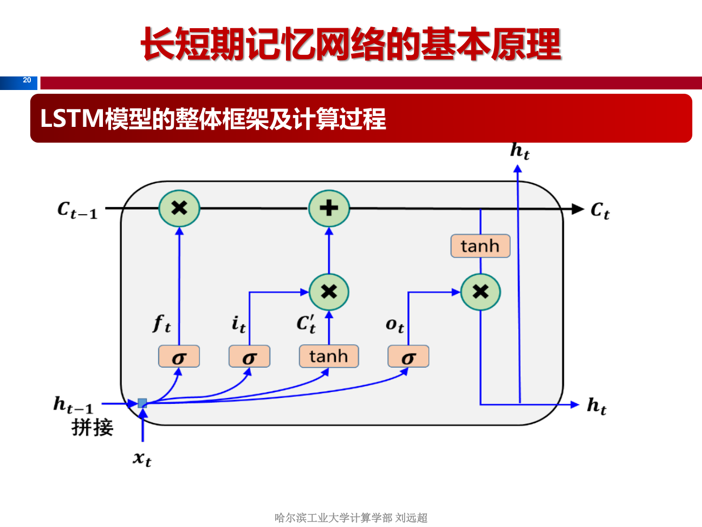
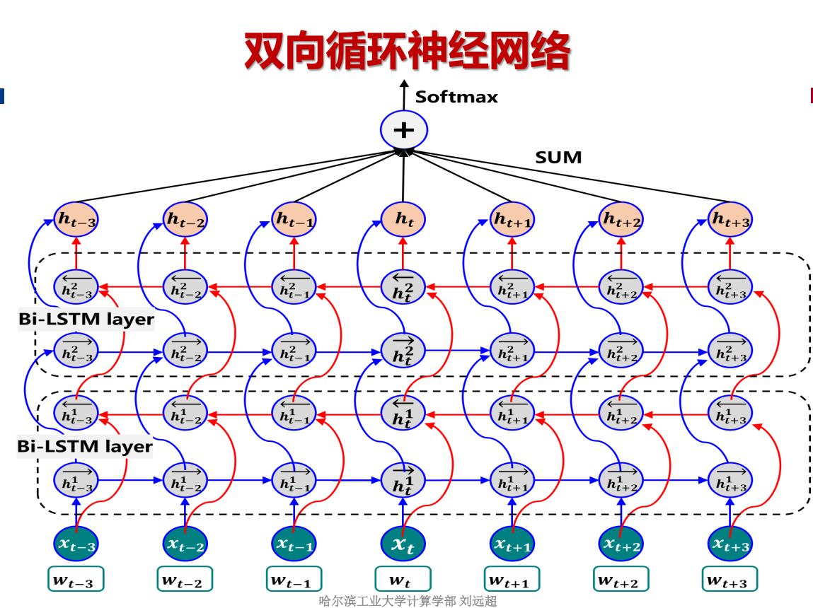
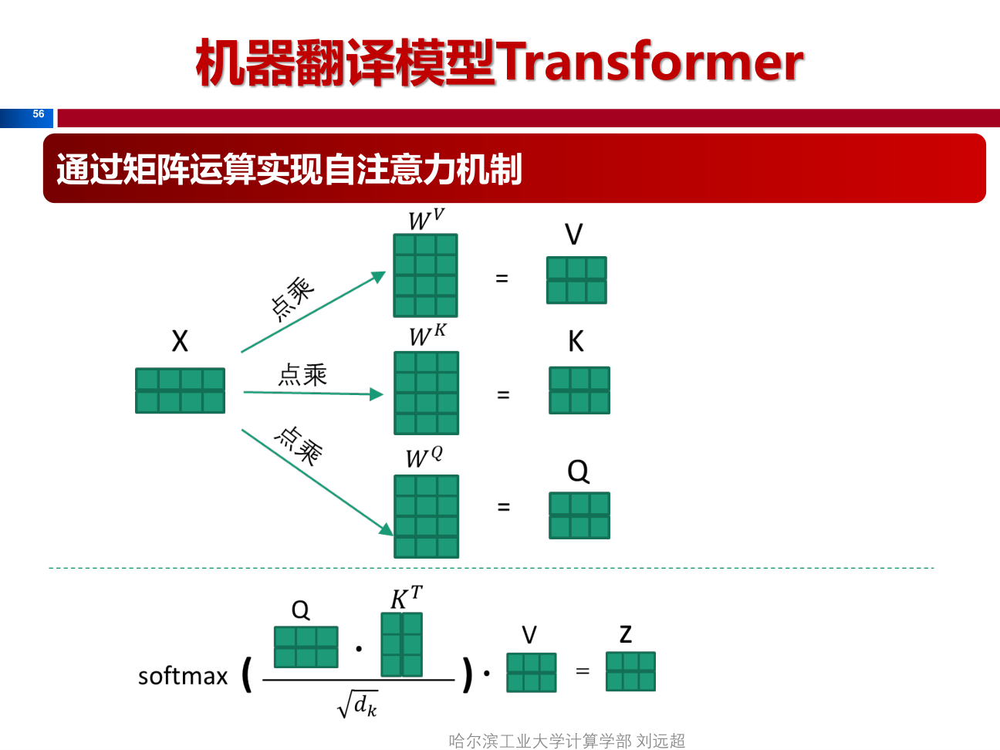

# 建模序列数据的神经网络

## 1. 序列任务与循环神经网络

序列数据具有顺序依赖：当前输入的含义往往与之前输入有关。

| 形式 | 输入与输出 | 典型用途（按结构解释） |
|---|---|---|
| 多对一 | 一个序列对应一个结果 | 句子情感分类 |
| 一对多 | 一个输入对应一串输出 | 图像描述生成 |
| 同步多对多 | 各时间步分别输出 | 序列标注 |
| 编码器—解码器 | 输入与输出序列长度可不同 | 机器翻译 |

基本 RNN 在当前输入与上一时刻隐藏状态的基础上更新：

$$
h_t=f(Ux_t+Wh_{t-1}),\qquad
o_t=\operatorname{softmax}(Vh_t).
$$

公式省略偏置。$U$ 为输入到隐藏层，$W$ 为隐藏状态之间，$V$ 为隐藏到输出层的权重；它们在不同时间步共享。共享表示同一种状态更新规则反复应用，参数数目不会随序列长度线性增加。

单向多对一模型常用最后一个隐藏状态分类，是因为信息沿时间方向汇聚到该状态；也可用池化或注意力汇聚。标准 RNN 在较长序列上容易因反复状态变换和梯度连乘而难以学习长期依赖。

## 2. LSTM：单元状态与门控

LSTM 除隐藏状态 $h_t$ 外，还维护单元状态 $c_t$。门由 Sigmoid 输出 $0$ 到 $1$ 之间的向量，通过逐元素乘法控制信息保留、写入和输出。

令 $u_t=[h_{t-1};x_t]$，则

$$
f_t=\sigma(W_fu_t+b_f),\qquad
i_t=\sigma(W_iu_t+b_i),
$$

$$
 c'_t=\tanh(W_cu_t+b_c),\qquad
c_t=f_t\odot c_{t-1}+i_t\odot c'_t,
$$

$$
o_t=\sigma(W_ou_t+b_o),\qquad
h_t=o_t\odot\tanh(c_t).
$$

| 部件          | 作用                  |
| ----------- | ------------------- |
| 遗忘门 $f_t$   | 决定旧单元状态保留多少         |
| 输入门 $i_t$   | 决定候选信息写入多少          |
| 候选状态 $c'_t$ | 提供当前可写入的新内容         |
| 输出门 $o_t$   | 决定单元状态的哪些部分反映在隐藏输出中 |

状态更新中的加法通路和可学习门控有利于长期信息传递。

## 3. LSTM 的变体与 GRU

三类变体：

- **猫眼连接（peephole）**：门在计算时额外观察单元状态。例如遗忘门和输入门可加入 $c_{t-1}$，输出门可加入 $c_t$。
- **耦合遗忘门与输入门**：令 $i_t=1-f_t$，使保留与写入相互约束，更新为 $c_t=f_t\odot c_{t-1}+(1-f_t)\odot\tilde c_t$。
- **GRU**：合并单元状态与隐藏状态，主要使用重置门和更新门，结构较精简。

GRU 写作

$$
r_t=\sigma(W_r[h_{t-1};x_t]),\qquad
z_t=\sigma(W_z[h_{t-1};x_t]),
$$

$$
\tilde h_t=\tanh\left(W[r_t\odot h_{t-1};x_t]\right),\qquad
h_t=z_t\odot\tilde h_t+(1-z_t)\odot h_{t-1}.
$$

这里 $z_t$ 越大，写入候选状态越多。不同资料可能把 $z_t$ 定义为保留旧状态的比例，比较公式时需要对应门的定义。

## 4. 双向循环神经网络

双向网络分别从左到右、从右到左处理同一输入，在每个位置组合两个方向的表示，使该位置同时利用前后文。下图把 **两层 Bi-LSTM 沿时间展开**；$t-3$ 到 $t+3$ 只是画出的七个位置，并不表示模型只能处理七个词。

按图从下往上看：

1. **输入**：最下方的 $w_i$ 是第 $i$ 个词，$x_i$ 是送入网络的词向量。每个 $x_i$ 同时送给第一层的两个方向。
2. **第一层双向 LSTM**：蓝色横向箭头从左往右递推，得到 $\overrightarrow h_i^{1}$；红色横向箭头从右往左递推，得到 $\overleftarrow h_i^{1}$。因此，在位置 $t$，前者编码到 $t$ 为止的左侧上下文，后者编码从右侧到 $t$ 的上下文。每个方向都有自己的 LSTM 状态和参数。
3. **第二层双向 LSTM**：竖向、弯曲的箭头表示把第一层同一位置的两个方向的结果送入第二层；第二层也各自沿蓝、红方向递推，得到 $\overrightarrow h_i^{2}$ 和 $\overleftarrow h_i^{2}$。图中的上标 $1,2$ 是层号，箭头是方向，不是求导符号。
4. **输出与分类**：每个位置顶部的 $h_i$ 汇合第二层两个方向的表示。图未说明这里具体是拼接还是相加，因此可先把 $h_i$ 理解为“同时包含左右文信息的位置表示”。所有位置的 $h_i$ 再经过顶部的 **SUM** 汇总成一个序列表示，最后由 **Softmax** 给出类别概率。这是一种“整段序列对应一个分类结果”的画法；顶部加号表示跨位置求和，不是 LSTM 单元内部的门控运算。

例如要判断整句情感，位置 $t$ 的表示既参考它前面的词，也参考它后面的词；随后把各位置的信息汇总，预测整句类别。图中省略了词向量生成方式及分类前可能使用的线性变换，重点是双向递推、两层堆叠和跨位置汇总。

双向结构适合能够获得完整输入的理解任务；逐步生成下一词时，未来词尚未出现，需要保持因果方向。

## 5. 注意力机制

注意力按当前任务所需的信息，对不同位置赋予不同权重。以句子表示为例：

$$
u_t=\tanh(W_wh_t+b_w),\qquad
\alpha_t=\frac{\exp(u_t^Tu_w)}{\sum_j\exp(u_j^Tu_w)},\qquad
c=\sum_t\alpha_th_t.
$$

$u_w$ 为可学习上下文向量，$\alpha_t$ 为不同词的注意力概率分布，$c$ 为汇总后的语义向量。这里每个隐藏状态都能直接参与句子表示，减少了只依赖最后一个状态的信息压缩。

## 6. Transformer 的编码器—解码器结构

原始 Transformer 以注意力为核心完成序列到序列建模，编码器理解源序列，解码器依据已有输出和源序列表示预测下一个词。

### 6.1 输入与位置编码

Transformer 将词嵌入和位置编码相加。正弦位置编码：

$$
PE_{pos,2i}=\sin\left(\frac{pos}{10000^{2i/d_{model}}}\right),\qquad
PE_{pos,2i+1}=\cos\left(\frac{pos}{10000^{2i/d_{model}}}\right).
$$

位置表示也可以通过训练学习。相比 RNN 的逐步递推，Transformer 在训练时可以并行计算多个位置；自回归生成仍按已有输出逐步继续。

### 6.2 缩放点积自注意力

设输入 $X\in\mathbb R^{T\times d_{model}}$，通过三个可学习矩阵生成

$$
Q=XW^Q,\qquad K=XW^K,\qquad V=XW^V.
$$

$$
\operatorname{Attention}(Q,K,V)=
\operatorname{softmax}\left(\frac{QK^T}{\sqrt{d_k}}\right)V.
$$

$QK^T$ 的第 $(i,j)$ 项衡量位置 $i$ 对位置 $j$ 的匹配度；按行 Softmax 后，对值向量 $V$ 加权求和，得到各位置的新表示。除以 $\sqrt{d_k}$ 控制点积分值尺度。

### 6.3 多头注意力

每个头使用独立的投影参数，分别计算关注关系，再拼接与投影：

$$
\operatorname{head}_i=\operatorname{Attention}(XW_i^Q,XW_i^K,XW_i^V),
$$

$$
\operatorname{MultiHead}(X)=\operatorname{Concat}(\operatorname{head}_1,\ldots,\operatorname{head}_h)W^O.
$$

### 6.4 残差、层归一化和前馈层

原始 Transformer 的 Post-LN 形式：

$$
\operatorname{Output}=\operatorname{LayerNorm}(x+\operatorname{Sublayer}(x)).
$$

LayerNorm 对每个位置的特征维做标准化，并学习缩放与偏移。前馈层对各位置分别应用相同的两层网络：

$$
FFN(x)=\max(0,xW_1+b_1)W_2+b_2.
$$

### 6.5 解码器与 Mask

解码器包括：

1. **Masked 自注意力**：当前位置只能关注已有目标词；训练时用因果掩码屏蔽未来位置。
2. **编码器—解码器注意力**：$Q$ 来自解码器当前子层表示，$K,V$ 来自编码器输出。
3. **前馈层及 Add & Norm**。
4. **线性层与 Softmax**：输出词表上的下一词概率。

## 7. 递归神经网络与情感组合

本章最后讨论的是 **Recursive Neural Network（递归神经网络）**。这里的 RNN 与前文的 **Recurrent Neural Network（循环神经网络）** 同缩写，但计算结构不同：循环网络沿时间链逐步更新隐藏状态；递归网络沿句法树从叶子到根，反复用同一个组合函数生成父节点。

### 7.1 为什么要沿树组合

判断“not very good”的情感，不能只看三个词各自的情感，还要看它们如何组合：可以先求“very good”这个短语的表示，再把“not”与该短语组合，得到整句表示。树的**叶节点**是词，**内部节点**是短语，**根节点**是整句；每个节点都能有自己的情感标签和预测结果。这一例子说明组合顺序的重要性，具体树形由句法分析结果决定。

### 7.2 标准递归神经网络：两个子节点合成一个父节点

设左右子节点的向量分别为 $b,c\in\mathbb R^d$。把它们上下拼接成 $[b;c]\in\mathbb R^{2d}$，父节点向量为

$$
p=\tanh\!\left(W[b;c]\right),\qquad W\in\mathbb R^{d\times 2d},\quad p\in\mathbb R^d.
$$

从词向量开始，对树中每个内部节点重复这一计算，直到得到根节点向量。**同一个 $W$ 在所有树节点共享**，因此无论句子有多少节点，都遵循相同的组合规则；这里的拼接保留了左右子节点的顺序。公式省略偏置项。

任意节点的向量 $a$（可以是词、短语或整句）都能送入分类器。若有 $C$ 个情感类别，则

$$
z=W_sa,\qquad y=\operatorname{softmax}(z),\qquad
y_j=\frac{e^{z_j}}{\sum_{k=1}^{C}e^{z_k}},\qquad W_s\in\mathbb R^{C\times d}.
$$

$y_j$ 是该节点属于第 $j$ 类的预测概率。标准模型的局限是：每个词只有一个向量，所有词对另一个词的影响都要经由同一个 $W$ 表达，组合方式较单一。

### 7.3 MV-RNN：用矩阵表示词对另一成分的作用

MV-RNN（Matrix-Vector RNN）为每个节点同时保存**语义向量**和**作用矩阵**。设左子节点为 $(b,B)$、右子节点为 $(c,C)$，其中 $b,c\in\mathbb R^d$，$B,C\in\mathbb R^{d\times d}$。计算父节点向量时，右节点的矩阵 $C$ 作用在左向量 $b$ 上，左节点的矩阵 $B$ 作用在右向量 $c$ 上

$$
p=\tanh\!\left(W[Cb;Bc]\right),\qquad W\in\mathbb R^{d\times 2d}.
$$

还要合成供上层使用的父节点矩阵。沿行拼接两个子矩阵后计算

$$
P=\tanh\!\left(W_M[B;C]\right),\qquad
W_M\in\mathbb R^{d\times 2d},\quad [B;C]\in\mathbb R^{2d\times d},\quad P\in\mathbb R^{d\times d}.
$$

词的矩阵可从单位矩阵加少量噪声开始学习。向量表示节点的内容，矩阵表示它如何改变另一节点的表示；两者一起向树的上层传递。相应的代价是每个词还需学习 $d\times d$ 个矩阵参数。

### 7.4 RNTN：用张量显式建模子节点间的相互作用

RNTN（Recursive Neural Tensor Network）仍以向量表示树节点，但在标准模型的线性组合之外加入张量项。令 $u=[b;c]\in\mathbb R^{2d}$，父节点计算可写为

$$
p=\tanh\!\left(
\begin{bmatrix}
u^TV^{[1]}u\\[-2pt]
\vdots\\[-2pt]
u^TV^{[d]}u
\end{bmatrix}
+Wu
\right),\qquad
V^{[k]}\in\mathbb R^{2d\times2d},\quad W\in\mathbb R^{d\times2d}.
$$

$V$ 有 $d$ 个矩阵切片，整体尺寸为 $2d\times2d\times d$；第 $k$ 个切片产生父向量的第 $k$ 个非线性组合分量。$u^TV^{[k]}u$ 包含向量分量之间的乘积，因而能直接表达两个子节点特征的相互作用；

$$
V^{[k]} = \begin{pmatrix} V_{11} & V_{12} \\ V_{21} & V_{22} \end{pmatrix}
$$

展开后：

$$
\begin{pmatrix} b \\ c \end{pmatrix}^T \begin{pmatrix} V_{11} & V_{12} \\ V_{21} & V_{22} \end{pmatrix} \begin{pmatrix} b \\ c \end{pmatrix} = \underbrace{b^T V_{11} b}_{\text{b内部特征交互}} + \underbrace{b^T V_{12} c}_{\text{b和c交互}} + \underbrace{c^T V_{21} b}_{\text{c和b交互}} + \underbrace{c^T V_{22} c}_{\text{c内部特征交互}}
$$

若将张量项置零，便退回标准递归网络的组合形式。这里的张量参数在树的各节点共享，并非每个节点单独拥有一套。

### 7.5 训练目标与阅读主线

对每个有标注的节点 $i$，用其向量计算预测分布 $y^{(i)}$，真实标签用 one-hot 向量 $t^{(i)}$ 表示。交叉熵累加各节点的预测误差，并加入参数正则化：

$$
E(\theta)=-\sum_i\sum_{j=1}^{C}t_j^{(i)}\log y_j^{(i)}+\lambda\|\theta\|_2^2.
$$

例如五分类的真实类别为第 5 类时，$t^{(i)}=[0,0,0,0,1]$；如果模型给该类的概率越小，该节点的损失越大。训练时误差会沿树从父节点传回子节点，更新词向量、组合参数和分类器参数。三种模型**都先自底向上得到节点表示，再对节点分类**，主要区别在于父节点如何由子节点合成：标准模型用共享矩阵，MV-RNN 让节点矩阵作用于另一节点向量，RNTN 用张量项建模特征乘积。
